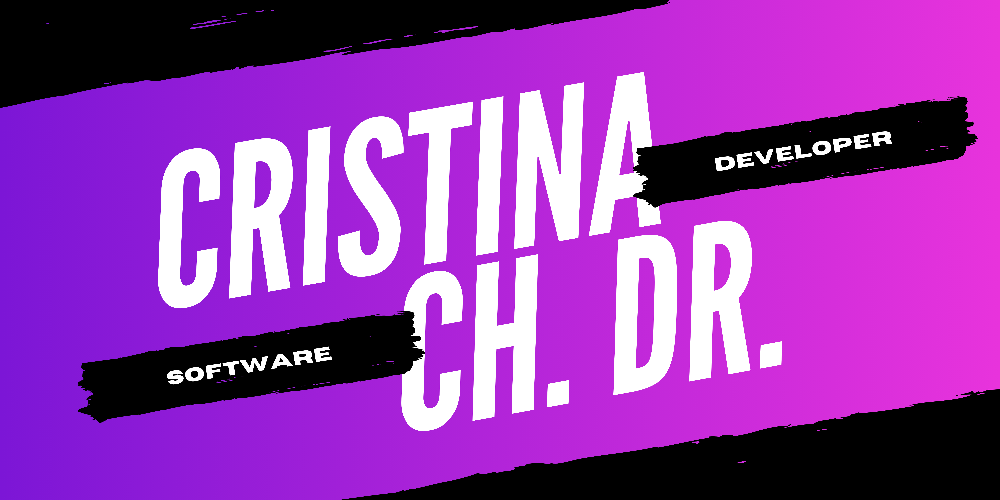

<h1 align="center">Hi 👋, I'm Cristina</h1>

<b>Junior Java & Spring Boot developer</b> · Full stack with Angular · Murcia, Spain

Recently graduated in Cross-platform Application Development (DAM) and always curious to learn new technologies.

## 👩‍💻 About me

- 🎓 **CFGS Desarrollo de Aplicaciones Multiplataforma** (2024-2026) at IES Alfonso X el Sabio, class representative both years
- 🏦 **Developer intern at NEORIS** (Mar 2026 - Jun 2026): built a banking application in a team with **Spring Boot + Angular**
  - Owned features end to end (bank account creation, savings "piggy banks"): entities, repositories, services, REST controllers, unit tests and the Angular frontend
  - Simple **Spring Batch** job for the automatic savings, and a migration to **hexagonal architecture**
  - Gitflow on GitHub, Kanban on Trello, biweekly demos (I led several of them) and coordination with the DevOps team for the AWS deployment
  - AI-assisted development with GitHub Copilot for refactoring and unit tests, always reviewing the output
- 📜 **Claude Code certificate** (2026) · English **B2** (Escuela Oficial de Idiomas)
- 🌱 Currently building **La Despensa**, a shared shopping list app with Java 21, Spring Boot, PostgreSQL and Angular
- 🔎 Looking for my first developer role: **backend Java/Spring** or **full stack Spring Boot + Angular**, hybrid in Murcia or remote in Spain

## 🛠️ Tech stack

**Backend:** Java 21 · Spring Boot · Spring Data JPA / Hibernate · Spring Batch · Lombok · Maven · JUnit · Mockito

**Frontend:** Angular · TypeScript · HTML · CSS · Bootstrap

**Databases:** PostgreSQL · Oracle (SQL, PL/SQL basics) · SQL Server

**Tools:** Git & GitHub (Gitflow) · GitHub Actions · IntelliJ IDEA · VS Code · Postman · Linux terminal · Trello

**Also worked with:** C# / .NET (WinForms, .NET MAUI) · Python (Qt, Tkinter) · JavaFX · JasperReports

   &emsp;
   &emsp;
   &emsp;
   &emsp;
   &emsp;
   &emsp;
   &emsp;
  

   &emsp;
   &emsp;
   &emsp;
   &emsp;
   &emsp;
   &emsp;
   &emsp;
   &emsp;
  

## 🌍 Languages

Spanish (native) · English (B2) · Ukrainian (intermediate)

## 📫 Contact

- ✉️ cristinachvartatska@gmail.com
- 💼 [LinkedIn](https://www.linkedin.com/in/cristina-chvartatska-drukholska-213225387/)

